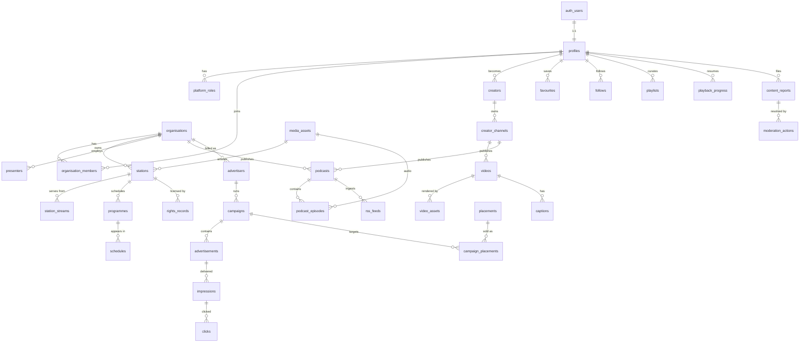

# System architecture

## Shape

```
        ┌──────────────┐  ┌──────────────┐  ┌──────────────┐  ┌────────────┐
        │ web (Next)   │  │ mobile (RN)  │  │ studio (Next)│  │ admin(Next)│
        └──────┬───────┘  └──────┬───────┘  └──────┬───────┘  └─────┬──────┘
               │                 │                 │                │
               └────────┬────────┴─────────┬───────┴────────────────┘
                        │                  │
                 anon/authenticated    edge functions (service role)
                        │                  │
                 ┌──────▼──────────────────▼───────┐
                 │        Supabase Postgres        │  ← system of record
                 │  RLS · triggers · partitions    │
                 └──────┬──────────────────┬───────┘
                        │                  │
          ┌─────────────▼────┐   ┌─────────▼──────────┐
          │ Cloudflare R2    │   │ Cloudflare Stream  │
          │ audio · images   │   │ video HLS + captions│
          └──────────────────┘   └────────────────────┘
                        ▲                  ▲
          broadcaster Icecast/Shoutcast/HLS origins (listener connects directly)
```

## Load-bearing decisions

| Concern | Decision | ADR |
|---|---|---|
| Repo | Turborepo + pnpm, four apps | 0001 |
| Identity | Supabase Auth + anonymous sessions | — |
| Security boundary | Postgres RLS + second-layer grants | 0006 |
| Live radio | direct to origin, no proxy, no seek | 0003 |
| Video | Cloudflare Stream behind a `provider` column | 0004 |
| Workers | cron-invoked handlers | 0007 |
| Local DB tests | throwaway Postgres + auth shim | 0008 |

## Why radio is not proxied

Proxying live audio through an edge function multiplies bandwidth cost, adds a
single point of failure between listener and station, and cannot improve quality.
The platform instead: verifies the endpoint before listing it, monitors it
continuously, and gives the client an ordered list of verified endpoints to fail
over between. Playback is recorded through a beacon, not through interception.

**The consequence is honest:** we cannot insert audio ads into third-party radio
streams. That is also the correct legal position (brief §9).

## Entity map (abridged)



## Table inventory (44 tables)

**Identity & tenancy:** profiles, platform_roles, organisations,
organisation_members, organisation_invitations, verification_requests
**Media:** media_assets
**Radio:** stations, station_streams, programmes, programme_presenters, presenters,
schedules, stream_health_checks (partitioned), stream_incidents
**Podcasts:** creators, creator_channels, podcasts, rss_feeds, podcast_episodes
**Video:** videos, video_assets, captions
**Engagement:** favourites, follows, playlists, playlist_items, playback_progress,
playback_events (partitioned), comments, reactions
**Advertising:** advertisers, placements, campaigns, advertisements,
campaign_placements, frequency_caps, impressions, clicks, payouts
**Trust & audit:** content_reports, moderation_actions, rights_records, audit_logs
**Notifications:** notification_preferences, push_tokens
**Reference:** content_categories, languages, regions

## Modelling rules

- **No polymorphic `target_id uuid`.** A favourite, follow, comment or report uses
  typed nullable FKs plus `CHECK (num_nonnulls(...) = 1)`, so every target is
  protected by a real foreign key.
- **Money is integer minor units.** UGX has no minor unit; budgets are `bigint`
  shillings. No float ever touches a budget or a payout.
- **Statuses are enums**, not free text: an invalid state is a database error.
- **Partitioned append-only tables** (`stream_health_checks`, `playback_events`)
  for volume without vacuum pain; they carry no inbound foreign keys.
- **`updated_at` is trigger-maintained** on every mutable table.
- **Search uses `to_tsvector('simple', …)`** — English stemming mangles Luganda
  and Runyankole.

## RLS matrix

| Table group | anon | authenticated (own) | org member | advertiser | moderator | admin |
|---|---|---|---|---|---|---|
| published stations / podcasts / episodes / videos | read | read | read | read | read | all |
| drafts, scheduled, blocked | — | — | read+write by role | — | read (comment moderation only) | all |
| `station_streams` | read **playable only** | — | read+write | — | — | all |
| `stream_health_checks`, `stream_incidents` | — | — | — | — | — | service only |
| `profiles` | public fields where handle set | own read/write of presentation fields | — | own | read | all |
| `platform_roles` | — | own rows | — | — | own | read |
| `rss_feeds` | — | — | read+write | — | — | all |
| `favourites/follows/playlists/progress` | — | own only | — | — | — | all |
| `playback_events` | insert (no profile) | insert own | — | — | — | read |
| `comments` | read visible | insert/update body/delete own via RPC | — | — | moderate via RPC | all |
| `campaigns`, `advertisements` | — | — | own advertiser | own org | — | all |
| `impressions`, `clicks` | — | — | read own | read own | — | read |
| `content_reports` | insert | insert + read own | — | insert | triage | all |
| `moderation_actions`, `audit_logs` | — | — | — | — | read/insert (no update/delete) | read |
| `rights_records` | — | — | owner/admin write | — | — | all |

## Business rules enforced in the database

| Rule | Mechanism | Tested |
|---|---|---|
| A station cannot publish without a verified org | `enforce_station_publishable` | `03_publish_gate` |
| …without at least one probed-playable stream | same trigger | `03_publish_gate` |
| …without a rights record in force for UG | same trigger | `03_publish_gate` |
| One primary stream endpoint per station | partial unique index | schema |
| One accepted owner per organisation | partial unique index | schema |
| No overlapping programme slots | `EXCLUDE USING gist` | schema |
| RSS ingestion is idempotent | `UNIQUE (podcast_id, guid)` | schema |
| Audit and moderation history is immutable | revoke + `reject_mutation` trigger | `04` |
| Clients cannot fabricate impressions | grants + no INSERT policy | `06` |
| Comment deletion and moderation are audited | RPCs (`delete_own_comment`, `moderate_comment`) | `04` |
